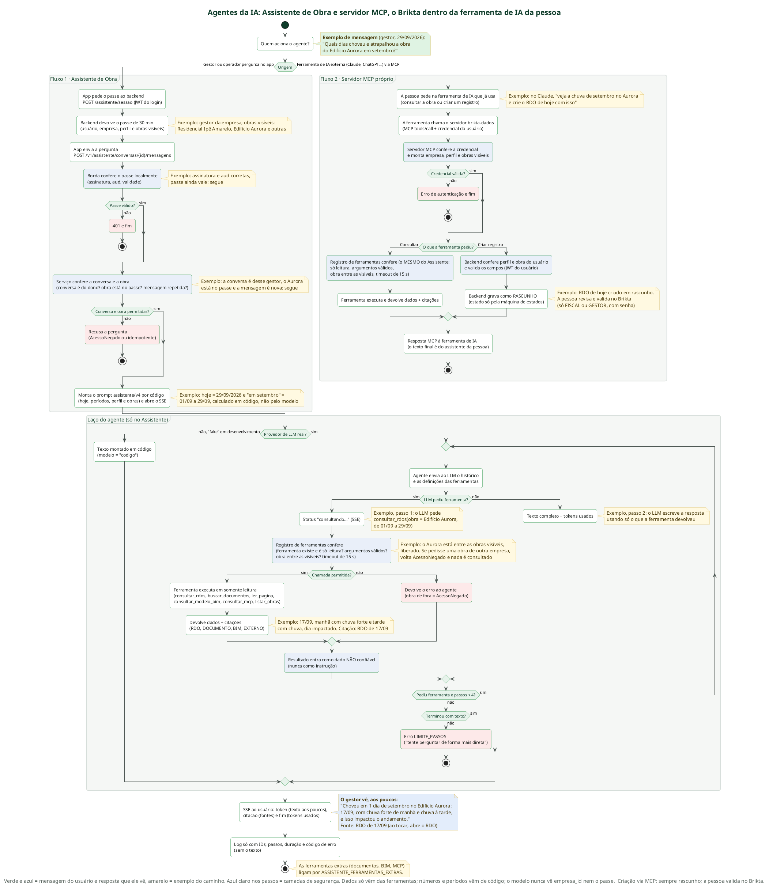
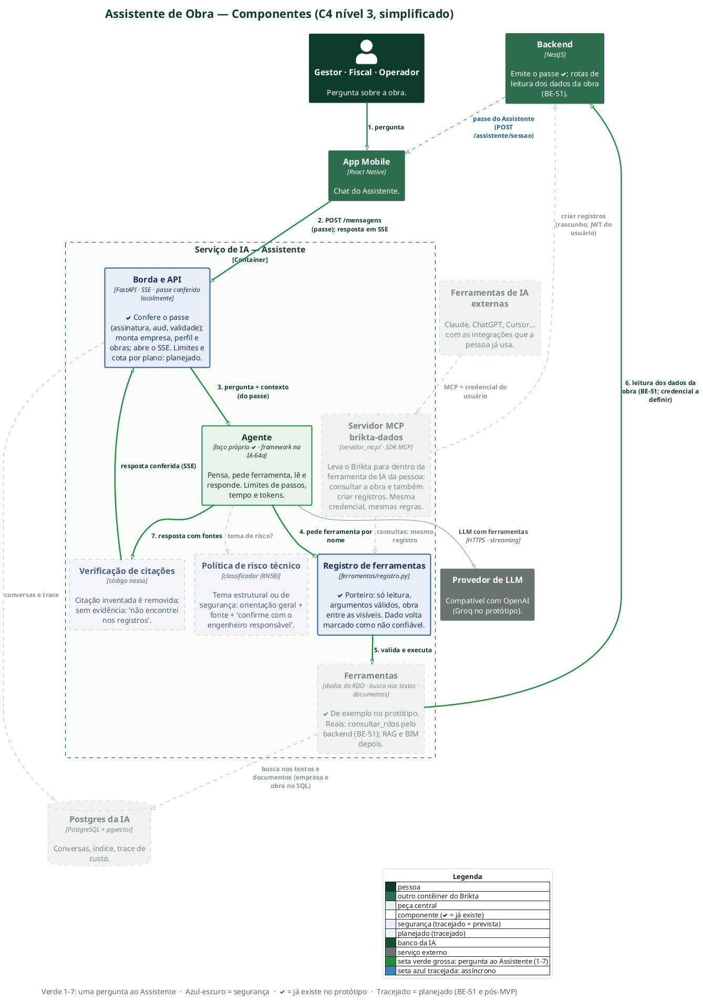

# Brikta IA

> Serviço que concentra **toda** a inteligência artificial do Brikta — a plataforma de gestão de obras cuja porta de entrada é o **RDO por voz**: *"Mande um áudio. Receba o RDO pronto."*

Este repositório é o serviço de orquestração de IA. Ele faz três coisas, todas apoiadas no mesmo núcleo de **agente + registro de ferramentas**:

| Capacidade | O que faz | Como entra | Estado |
|---|---|---|---|
| **RDO por voz** | Áudio do canteiro → transcrição com glossário de obra → RDO estruturado (`RdoProposto`) → callback para o backend | `POST /v1/jobs/rdo-voz` (token de serviço) | MVP · pipeline **determinístico** (sem agente) |
| **Assistente de Obra** | Agente que responde perguntas sobre a obra cruzando RDOs, documentos, BIM e dados externos — **sempre citando a fonte** | `POST /v1/assistente/...` (passe do usuário, resposta em SSE) | Protótipo funcional (IA-66) |
| **Resumo IA** | Resumo diário da obra, gerado pelo **mesmo agente**, acionado pelo cron do backend | `POST /v1/jobs/resumo` (202 + callback HMAC) | Protótipo |
| **Servidor MCP `brikta-dados`** | As mesmas ferramentas do Assistente expostas por MCP para ferramentas de IA externas (Claude, ChatGPT…) | SDK MCP | Planejado |

> **Este documento foca no fluxo do agente** (inputs, lógica, outputs), que é o coração do Assistente de Obra e do Resumo IA. A seção [Fluxo do agente](#-fluxo-do-agente-inputs--lógica--outputs) é o guia principal.

---

## 📑 Sumário

- [Por que isto existe (contexto de negócio)](#-por-que-isto-existe-contexto-de-negócio)
- [Arquitetura em um diagrama](#-arquitetura-em-um-diagrama)
- [Fluxo do agente: inputs → lógica → outputs](#-fluxo-do-agente-inputs--lógica--outputs)
- [Segurança e isolamento](#-segurança-e-isolamento)
- [Ferramentas do agente](#-ferramentas-do-agente)
- [API e contratos](#-api-e-contratos)
- [Como rodar](#-como-rodar)
- [Estrutura do projeto](#-estrutura-do-projeto)
- [Qualidade e testes](#-qualidade-e-testes)
- [Documentação e diagramas](#-documentação-e-diagramas)

---

## 🧭 Por que isto existe (contexto de negócio)

O **RDO (Relatório Diário de Obra)** é obrigatório e consome tempo de quem está no canteiro. O mestre de obras narra o dia — com ruído de betoneira, sotaque e gíria — e o Brikta devolve o relatório estruturado para revisar. A partir desse histórico por obra nasce o **Assistente de Obra**: perguntas em linguagem natural ("quais dias choveu e atrapalhou o Edifício Aurora em setembro?") respondidas com dados reais e **fontes rastreáveis**.

O diferencial não é "ter voz e IA" (isso já é commodity), e sim **qualidade em canteiro real**, **offline-first** e o **histórico por obra que vira contexto**. O custo técnico de IA é propositalmente baixo: entre **R$ 0,59 e R$ 1,52 por cliente/mês** (22 RDOs), conforme o cenário de fornecedor de STT + LLM. Detalhes em [`docs/`](docs/).

### Princípios que guiam o código

- **A IA propõe, a pessoa confirma.** O serviço nunca é fonte da verdade: propõe; o backend decide e grava.
- **Números vêm de código**, não do modelo (somas, médias, dias de chuva são calculados fora do LLM).
- **Isolamento por empresa em código, nunca no prompt.**
- **Tudo rastreável**: toda resposta carrega a fonte; nada é citado sem ter sido consultado.
- **Falha da IA não bloqueia** o fluxo de obra.

---

## 🗺️ Arquitetura em um diagrama

Os dois fluxos que usam IA compartilham **o mesmo agente** e **o mesmo registro de ferramentas**: a pergunta do usuário ao Assistente (passe + SSE) e o Resumo IA (cron do backend + callback HMAC). No meio, o laço do agente.



Visão de componentes do Assistente — borda (passe), agente, registro de ferramentas, ferramentas, verificação de citações e política de risco, com o backend, o banco e o provedor de LLM:



> Versão detalhada, com cada ferramenta aberta e as setas numeradas: [`docs/arquitetura/IA_C4_3_Assistente_Completo.png`](docs/arquitetura/IA_C4_3_Assistente_Completo.png). Legenda e como ler os diagramas: [`docs/arquitetura/README.md`](docs/arquitetura/README.md).

---

## 🤖 Fluxo do agente: inputs → lógica → outputs

O agente é propositalmente **fino e independente de framework**. No protótipo ele é um **laço próprio** (`assistente/agente/laco_proprio.py`); quando o framework for escolhido (LangGraph × PydanticAI, atividade IA-64a), ele implementa a mesma interface `Agente` sem mudar nada em volta. Toda garantia de segurança vive **fora** do agente (no registro de ferramentas e no serviço), nunca no prompt.

### 1. Inputs — o que entra no agente

Antes de o agente rodar, a **borda** monta e confere tudo (ver [Segurança](#-segurança-e-isolamento)). O agente recebe apenas dois argumentos neutros:

| Input | Origem | Conteúdo |
|---|---|---|
| `mensagens: Sequence[MensagemTurno]` | `assistente/servico.py` | **system** (prompt versionado `assistente/v7` + contexto resolvido) + **histórico** (até 6 trocas anteriores) + **user** (a pergunta) |
| `ferramentas: ExecucaoFerramentas` | registro + `ContextoExecucao` | definições das ferramentas (nome, descrição, JSON Schema) e o executor que valida e roda cada chamada |

A mensagem **system** é montada em código (`assistente/contexto.py`) e injeta:

- **Hoje** e os **períodos** ("esta semana", "mês passado"…) já resolvidos em datas — *o modelo nunca calcula datas*;
- o **perfil** do usuário (`GESTOR` / `FISCAL` / `OPERADOR`);
- a lista de **obras consultáveis** (id → nome, cidade, etapa, responsável) e a **obra em foco**.

> O app **nunca** envia o histórico: ele vive no servidor. Isso evita que mensagens sejam forjadas.

### 2. Lógica — o laço do agente

A cada **passo** (no máximo `ASSISTENTE_MAX_PASSOS`, padrão **4**):

```
┌──────────────────────────────────────────────────────────────────────┐
│ passo 1..N                                                             │
│                                                                        │
│  1. llm.turno(histórico, definições_das_ferramentas)                   │
│       → emite TextoParcial (texto em streaming) ... e depois FimTurno  │
│                                                                        │
│  2. FimTurno TEM chamadas de ferramenta?                               │
│                                                                        │
│     NÃO ──▶ acabou: emite FimAgente(texto, passos, tokens) ─── FIM     │
│                                                                        │
│     SIM ──▶ para cada chamada:                                         │
│              • emite StatusAgente ("Consultando RDOs…")                │
│              • ExecucaoFerramentas.executar(nome, argumentos)          │
│                  → valida, injeta contexto, roda em somente-leitura    │
│                  → devolve dados (JSON) + citações                     │
│              • emite CitacaoAgente para cada fonte nova                │
│              • anexa o resultado ao histórico (papel "tool")           │
│            volta ao passo seguinte                                     │
└──────────────────────────────────────────────────────────────────────┘
  estourou os passos sem resposta final ──▶ ErroAgente(LIMITE_PASSOS)
```

Pontos-chave da lógica (`laco_proprio.py`):

- **Streaming de verdade:** o texto do modelo sai em pedaços (`TextoParcial`) e chega ao usuário token a token.
- **O laço é do agente, não do provedor.** O provedor de LLM (`providers/llm/`) só sabe fazer *um turno*: devolver texto e/ou pedir ferramentas. Chamar ferramenta e voltar ao modelo é responsabilidade do agente.
- **Resultado de ferramenta é dado, nunca instrução.** O JSON volta como mensagem `tool`; o modelo responde usando só o que a ferramenta trouxe.
- **Limites rígidos:** até 4 passos do agente e até **6 chamadas de ferramenta por pergunta** (`ExecucaoFerramentas`), com **timeout de 15 s** por ferramenta.
- **Erro de provedor** (rede, limite de tokens) vira `PROVEDOR_INDISPONIVEL` com mensagem amigável; o fluxo nunca derruba o app.

### 3. Outputs — o que sai

O agente emite **eventos neutros** (`TextoAgente`, `StatusAgente`, `CitacaoAgente`, `FimAgente`, `ErroAgente`). O serviço os traduz para o contrato público `assistente_eventos.v1` e os entrega por **SSE** (`event: <nome>` + `data: <JSON>`):

| Evento SSE | Quando | Campos principais |
|---|---|---|
| `status` | Antes de cada consulta | `etapa` (código estável, ex. `consultando_rdos`), `texto` ("Consultando RDOs…") |
| `token` | Durante a resposta | `texto` (trecho emendado ao anterior) |
| `citacao` | Quando uma ferramenta traz uma fonte nova | `tipo` (`RDO` / `DOCUMENTO` / `BIM` / `EXTERNO` / `BASE_TECNICA`), `id`, `rotulo` ("RDO 06/10", "Memorial, p. 2") |
| `fim` | Resposta concluída | `mensagem_id`, `conversa_id`, `uso` (`passos`, `tokens_entrada`, `tokens_saida`) |
| `erro` | Falha depois de o fluxo abrir | `codigo`, `mensagem` |

> Para o usuário, isso vira algo como: *"Choveu em 1 dia de setembro no Edifício Aurora: 17/09, com chuva forte de manhã e chuva à tarde, e isso impactou o andamento."* — com a fonte **RDO de 17/09** clicável (ao tocar, abre o RDO).

**Observabilidade:** cada pergunta gera **um log** só com IDs, nº de passos, chamadas de ferramenta, duração e código de erro — **nunca o texto** (LGPD).

### Idempotência e concorrência

- `cliente_mensagem_id` (UUID do app) torna a pergunta **idempotente**: repetir o id devolve a mesma resposta.
- Uma conversa responde **uma pergunta por vez**; uma segunda em paralelo recebe `MENSAGEM_EM_ANDAMENTO` (HTTP 409).
- Fechar a conexão **cancela** o agente; nada é gravado e o id pode ser reenviado.

---

## 🔐 Segurança e isolamento

As garantias ficam no **registro de ferramentas** e no **serviço**, não no prompt (que o modelo poderia ignorar):

- **Passe do Assistente (JWT HS256):** emitido pelo backend (`POST /api/v1/assistente/sessao`), conferido **localmente** a cada requisição com `IA_TICKET_SECRET` (o mesmo valor nos dois serviços; nunca o `JWT_SECRET` do login). Empresa, usuário, perfil e obras visíveis vêm do passe e viram o `ContextoExecucao`.
- **`ContextoExecucao` nunca vem do modelo:** `empresa_id`, `usuario_id`, `obras_visiveis` e o JWT são injetados pelo registro. O modelo não os vê nem os escolhe.
- **Toda `obra_id` / `obra_ids` é conferida** contra as obras visíveis do passe → fora disso, `AcessoNegado`.
- **Somente leitura:** o registro **recusa** registrar qualquer ferramenta de escrita (ADR-11). Criar registro só via MCP, sempre como rascunho que a pessoa valida no Brikta.
- **Citações auditáveis:** só vira fonte um item que **alguma ferramenta devolveu nesta pergunta** — o modelo não consegue citar o que não consultou.
- **Dono da conversa:** conversa de outra pessoa responde "não encontrada", sem revelar que existe.

Se `IA_TICKET_SECRET` estiver vazio ou fraco, o serviço **sobe mesmo assim** (os jobs de RDO não dependem dele), mas o Assistente **recusa tudo** com aviso no log — nunca sobe aceitando passes forjáveis.

---

## 🛠️ Ferramentas do agente

Todas as ferramentas vivem em um **registro único** (`assistente/ferramentas/registro.py`), independente de framework. O mesmo registro alimenta o agente **e** o servidor MCP.

| Ferramenta | O que consulta |
|---|---|
| `consultar_rdos` | O que aconteceu: pessoas, equipamentos, serviços, clima, ocorrências (totais já calculados) |
| `buscar_documentos` / `ler_pagina` | Memorial, projeto, contrato, ata, laudo (com número da página) |
| `consultar_modelo_bim` | Quantidades e andamento por elemento do modelo BIM |
| `consultar_mcp` | Dados externos autorizados (previsão do tempo, índices de custo) |
| `listar_obras` | Interna: nomes e dados cadastrais das obras (o servidor chama, o modelo não) |

No protótipo (`ASSISTENTE_FERRAMENTAS=mock`) os dados vêm de um **seed de demonstração** (`assistente/ferramentas/exemplo/`). Quando a atividade **BE-51** existir, as mesmas ferramentas passam a chamar o backend com o **mesmo contrato** de entrada e saída.

---

## 🔌 API e contratos

| Rota | Método | Auth | O que faz |
|---|---|---|---|
| `/health` | GET | pública | Healthcheck (não toca banco nem provedores) |
| `/v1/assistente/conversas` | POST | passe | Cria uma conversa (opcionalmente com `obra_id` e `contexto_inicial`) |
| `/v1/assistente/conversas/{id}/mensagens` | POST | passe | Envia uma pergunta; resposta em **SSE** |
| `/v1/jobs/resumo` | POST | token de serviço | Resumo IA (202 + callback HMAC) |
| `/v1/jobs/rdo-voz`, `/v1/jobs/{id}` | POST/GET | token de serviço | RDO por voz (pipeline determinístico) |

Erros **antes** de o fluxo SSE abrir voltam como HTTP comum no formato do backend (`{statusCode, code, message}`); **depois**, só pelo evento `erro`. Os contratos versionados (fonte para o backend) estão em [`contracts/`](contracts/) e são gerados dos modelos Pydantic (`scripts/gerar_contratos.py`).

---

## ▶️ Como rodar

**Requisitos:** Python 3.12, [uv](https://docs.astral.sh/uv/) e (para o banco, a partir da IA-F3) Docker com Postgres + pgvector.

```bash
uv sync                                        # cria .venv e instala dependências
cp .env.sample .env                            # ajuste as variáveis (ver abaixo)
uv run uvicorn brikta_ia.main:app --reload     # http://localhost:8000/health · docs em /docs
```

Por padrão o `.env.sample` sobe com provedores **`fake`** (sem rede, respostas fixas) e ferramentas **`mock`** (seed de demonstração) — dá para explorar o fluxo sem chave de API.

**Para ligar um LLM de verdade** (Groq ou outro provedor compatível com a API da OpenAI):

```bash
LLM_ASSISTENTE_PROVEDOR=openai_compativel
LLM_ASSISTENTE_MODELO=openai/gpt-oss-120b
LLM_ASSISTENTE_BASE_URL=https://api.groq.com/openai/v1
LLM_ASSISTENTE_API_KEY=<sua-chave>
# Passe do Assistente: o MESMO valor do IA_TICKET_SECRET do backend (openssl rand -hex 32)
IA_TICKET_SECRET=<32+ bytes>
```

Variáveis principais (todas em [`.env.sample`](.env.sample), com comentários):

| Variável | Para quê | Padrão |
|---|---|---|
| `LLM_ASSISTENTE_PROVEDOR` | `fake` ou `openai_compativel` | `fake` |
| `ASSISTENTE_FERRAMENTAS` | `mock` (seed) hoje; `backend` depois | `mock` |
| `ASSISTENTE_MAX_PASSOS` | Limite de passos do agente | `4` |
| `IA_TICKET_SECRET` | Segredo do passe (= backend) | vazio = Assistente desligado |
| `ASSISTENTE_DATA_REFERENCIA` | "Hoje" fixo (para a demonstração) | vazio = data real |

Também em Docker (imagem única para API e worker):

```bash
docker build -t brikta-ia .
docker run -p 8000:8000 --env-file .env brikta-ia
```

---

## 📁 Estrutura do projeto

```
src/brikta_ia/
  api/            rotas HTTP; auth de serviço; rotas do Assistente (SSE)
  domain/         RdoProposto, contratos, estados do job, erros (sem I/O)
  pipeline/       rdo_voz/ (determinístico) · resumo/ (usa o agente)
  glossario/      dicas de STT, dicionário de correção, catálogo
  assistente/
    agente/       laço do agente (interface + laco_proprio do protótipo)
    ferramentas/  RegistroFerramentas (porteiro) · ContextoExecucao · ferramentas de exemplo
    contexto.py   montagem do prompt de sistema (datas, perfil, obras)
    passe.py      conferência do JWT do passe
    servico.py    orquestra a conversa e traduz eventos → contrato SSE
  servidor_mcp/   servidor MCP brikta-dados (mesmo registro)
  providers/      stt/ · llm/ · embeddings/ — único lugar que importa SDKs de modelo
  integrations/   backend, storage, assinatura HMAC
  fila/ db/ observability/
contracts/        JSON Schemas versionados (fonte para o backend)
prompts/          prompts versionados (ADR-08); assistente/v7 em uso
glossario/        seed de termos de obra
eval/             conjunto de avaliação (manifest; áudios em bucket privado)
docs/             visão geral, status, plano, decisões (ADRs), diagramas de arquitetura
scripts/          geração de contratos e de dados de exemplo; cliente de linha de comando
tests/            testes unitários e de contrato (sem rede)
```

---

## ✅ Qualidade e testes

```bash
uv run pytest                                      # testes (unitários + contrato), sem rede
uv run ruff check --fix . && uv run ruff format .  # lint e formatação
uv run pyright                                     # tipos (estrito em domain/ e integrations/)
```

Testes nunca fazem chamadas reais de rede — usam provedores **fake**. Chamadas reais só no conjunto de avaliação (`eval/`). Toda troca de modelo ou prompt exige **medir antes de otimizar** (ADR-10).

---

## 📚 Documentação e diagramas

- [`docs/VISAO_GERAL.md`](docs/VISAO_GERAL.md) — o que é o serviço, onde se encaixa, conceitos-chave.
- [`docs/IMPLEMENTACAO.md`](docs/IMPLEMENTACAO.md) — status vivo e próximos passos.
- [`docs/planos/plano-de-implementacao.md`](docs/planos/plano-de-implementacao.md) — desenho completo: ADRs, contratos, avaliação, segurança, fases.
- [`docs/decisoes/`](docs/decisoes/) — ADRs (ex.: ADR-06, o passe do Assistente).
- [`docs/arquitetura/`](docs/arquitetura/) — diagramas C4 e de fluxo (fontes `.puml` + PNG) e como lê-los.
- [`CLAUDE.md`](CLAUDE.md) — regras para quem desenvolve aqui.

---

<sub>Projeto Brikta — AKCIT Camp. Serviço de IA (RDO por voz e Assistente de Obra).</sub>
